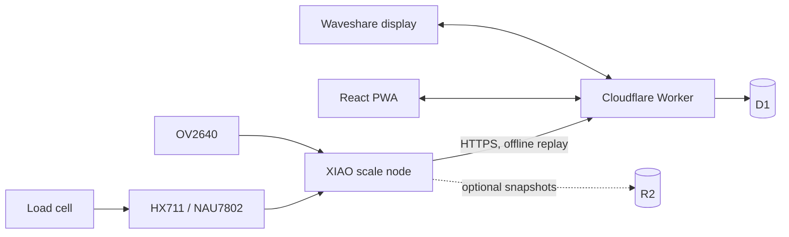

# FeedMe2 — scale and camera software architecture

Status: proposed; not implemented. Baseline: `main` commit `3eb62df943367bf241d8cf724214b7053239e486` (2026-10-13).

## Current repository
- `shared/`: TypeScript Zod contracts, unit/hunger/report logic and fixtures.
- `backend/`: Hono Cloudflare Worker + D1, house/device tokens, pairing, feeding API and reports.
- `webapp/`: React/Vite PWA.
- `firmware/`: C++17 PlatformIO, `domain/ports/application/adapters/screens`; currently targets CrowPanel 1.28 GC9A01, Wokwi and native tests.
- `tools/device-sim/`: simulated device API client.
- Phase 5a QR login PR #5 **merged** on 2026-10-13. Root `handoff.md` still describes it as unmerged; confirm actual deployment/migration separately. Firmware Phase 3 remains paused for hardware changes.
- Current `shared/src/device.ts` `HwModelSchema` permits only `crowpanel-1.28`, `simulator`, `device-sim`. No scale events or camera contracts.

## Architecture decision
Add a **separate headless scale node**, XIAO ESP32S3 Sense + OV2640 + HX711 and 1 kg beam (NAU7802 later). Do not rewrite existing manual feeding semantics. Optional Waveshare AMOLED 1.75 is a **separate firmware target and device identity**.

## Domain boundaries
- **FeedingLog**: existing user-logged feeding, never inferred from weight by default.
- **ScaleObservation**: timestamped gross stable mass, variance, device sequence, calibration revision and bowl-presence state.
- **BowlProfile**: empty mass, tolerance and revision; bowls of equal mass may be equivalent but cannot be uniquely identified.
- **FoodAddition**: inferred delta across lift/return, with confidence/review status, not equal to consumed food.
- **ImageCapture**: optional, separately controlled and retained.
- **DeviceManagement**: reuse pairing, device token scope, telemetry and OTA concepts.

## Scale state machine
`UNINITIALIZED -> EMPTY_PLATFORM -> BOWL_PRESENT_STABLE -> BOWL_LIFTED -> BOWL_RETURNED_SETTLING -> BOWL_PRESENT_STABLE`; `FAULT` reachable from every state. Define stable mass using rolling variance and dwell time **from bench calibration**, not arbitrary thresholds. Before lift snapshot `beforeGrossMg`, profile/revision, observation ID. After return wait for stable mass and compatible bowl profile; `deltaMg = afterGrossMg - beforeGrossMg`. Positive delta = candidate addition; negative delta = candidate removal/correction. Ambiguous bowl, platform contact, nonstable readings or calibration mismatch -> `needsReview`. Registration gesture: put empty bowl on platform 3–5 s, then remove; allow explicit correction.

## Proposed API (new; not yet implemented)
- Extend hardware model enum; consider capability set (`weight_observation`, `camera_capture`, `display`, `manual_feed`) rather than treating model as capability.
- `POST /api/device/scale-events`: bounded batch of device-generated UUID events with monotonic sequence, timestamps, event type, stable mass (integer mg), calibration version and stability metadata. Dedupe by event ID, scope device and house **only from verified device token**.
- Extend `GET /api/device/state` with optional scale configuration, profile revisions, capture policy; preserve existing clients.
- D1 migration **new numbered file** for `scale_events`, `scale_calibrations`, `bowl_profiles`, `food_additions`, optionally `image_assets`. Integer mg and epoch ms; avoid SQL REAL.
- Preserve original device observation time and server receive time. Sequence + UUID protect offline replay.
- Do **not** add inferred food additions to `feedings` automatically or relabel existing source values without explicit product decision.

## Firmware modules
- `domain/scale/`: pure C++ state machine, weight stability, profile match, deltas.
- `ports/`: `IWeightAdc`, `ICamera`, `IEventStore`, `ICalibrationStore`, clock/network.
- `adapters/xiao/`: HX711 (future NAU7802), OV2640, NVS, LittleFS outbox, Wi-Fi/TLS.
- `application/`: `ScaleService`, `BowlRegistrationService`, `EventSyncService`, optional `CapturePolicyService`.
- New PlatformIO `xiao-scale` environment, separate from `crowpanel`. Keep `domain/` and `application/` free of Arduino, ESP-IDF and LVGL headers as required by `CLAUDE.md`.
- Offline durable queue with event IDs, bounded flash writes, retry/backoff and crash-safe replay. Reuse pairing and backend 401 behavior; do not copy current insecure TLS setting from CrowPanel.

## PWA / reports
Manual Feed remains functional without any scale. New Scale panel: current stable food mass, bowl profile, calibration, last additions, review/correction and device health. Reports must distinguish logged feedings from measured additions; a comparison view can be added explicitly. Camera uploads are disabled until capture triggers, access controls, retention and consent are decided.

## Test strategy
TDD with native Unity tests and cross-tier JSON vectors. Cases: noise, stability, lift/return, multiple equivalent bowls, ambiguous/mismatched bowl, negative delta, calibration change, disconnected operation, reboot, duplicate event, out-of-order events, clock skew, saturation/overload and sensor faults. Backend contract tests for auth, validation, idempotency, house scoping, migration and payload caps; PWA Playwright for review/correction; physical bench calibration before production.

## Implementation phases
1. ADR and baseline/contract review; fix stale root handoff.
2. Shared Zod schemas, fixture vectors, D1 migration, event ingest with tests.
3. Native scale state machine + simulated ADC stream.
4. XIAO/HX711 bench integration, calibration and mechanical overload validation.
5. PWA scale and bowl-management UI.
6. Camera optional R2 capture with privacy/retention controls.
7. Waveshare display firmware target, independent of scale.
8. OTA, security hardening and end-to-end deployment.

## Open decisions
Should inferred additions be saved immediately with correction, or require confirmation? Default proposal: inferred event + review. Should images leave the device? Default: no until explicit opt-in. Multiple scale devices/bowls per house? Design for yes. Power: USB + Wi-Fi for MVP. Real calibration must determine stability/tolerances and safe load.

## References
- [Main repo](https://github.com/a-tsygankov/feedme2)
- [Current API schema](https://github.com/a-tsygankov/feedme2/blob/main/shared/src/device.ts)
- [Repo conventions](https://github.com/a-tsygankov/feedme2/blob/main/CLAUDE.md)
- [Current firmware target](https://github.com/a-tsygankov/feedme2/blob/main/firmware/platformio.ini)
- [QR login merge](https://github.com/a-tsygankov/feedme2/commit/3eb62df943367bf241d8cf724214b7053239e486)
